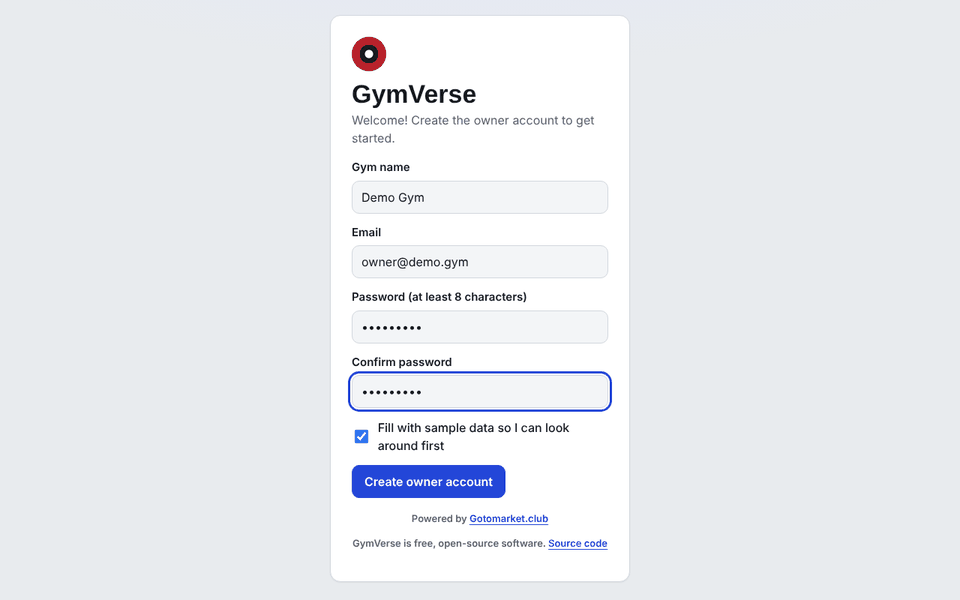
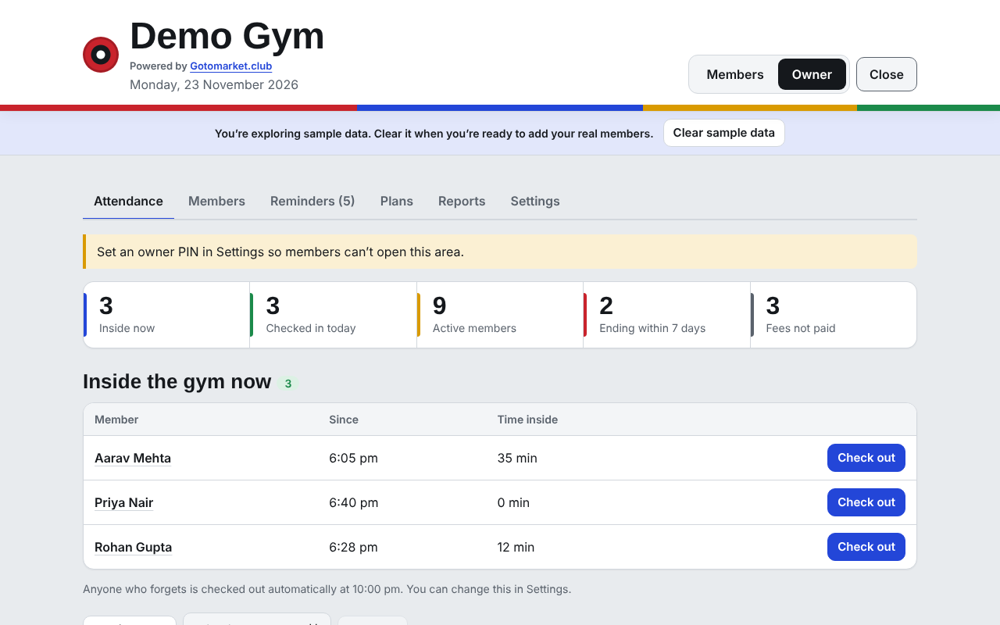
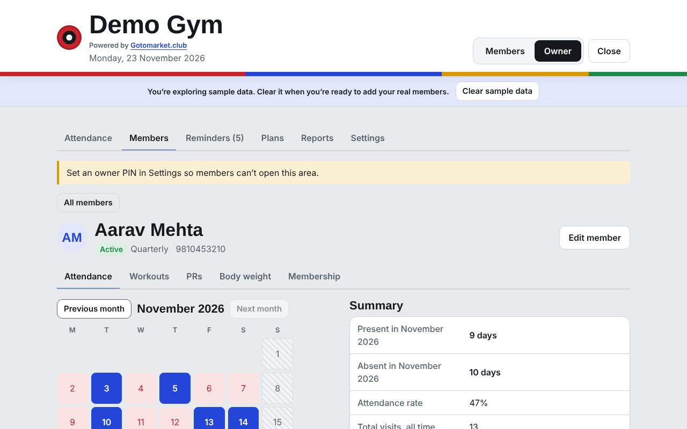
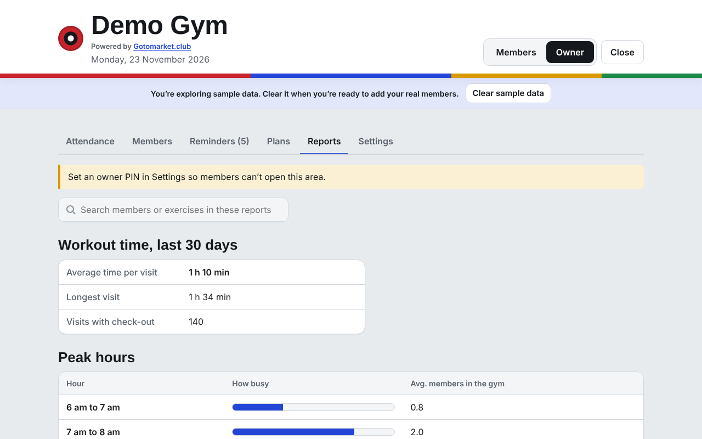
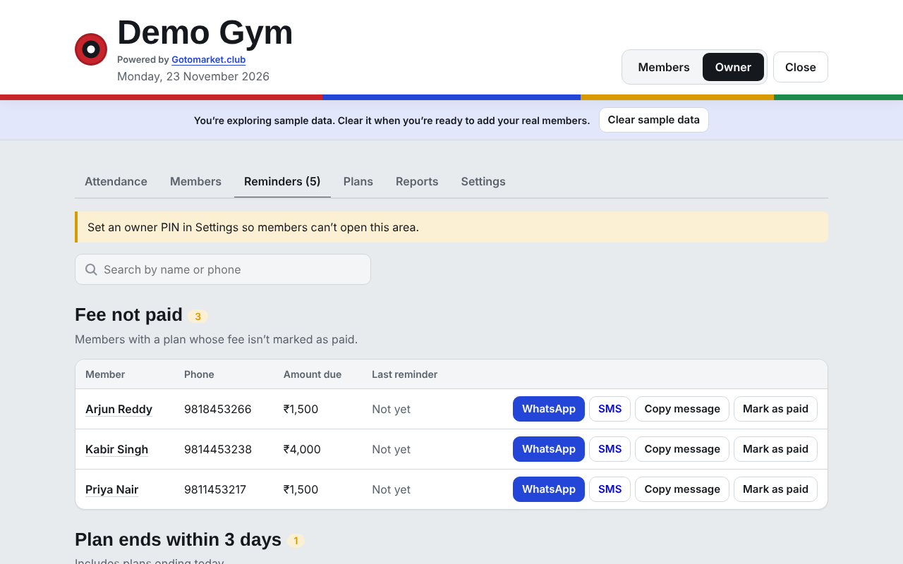
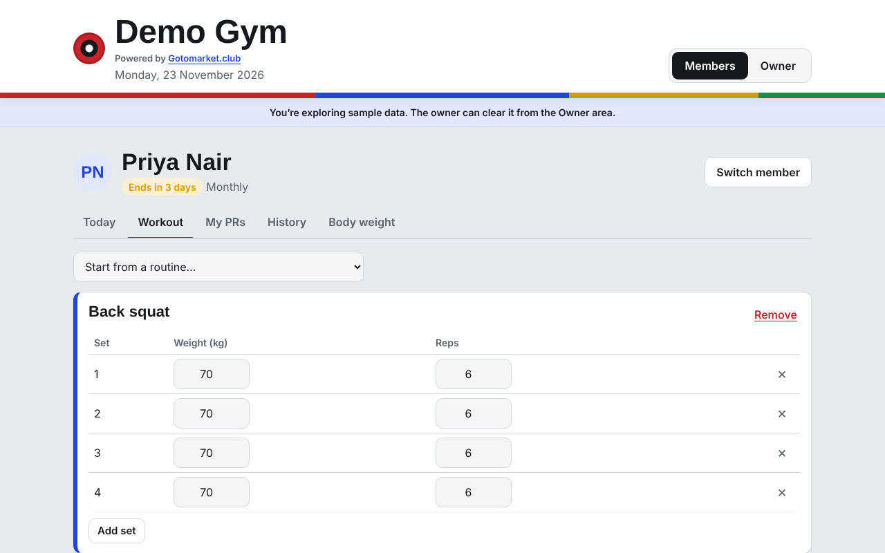
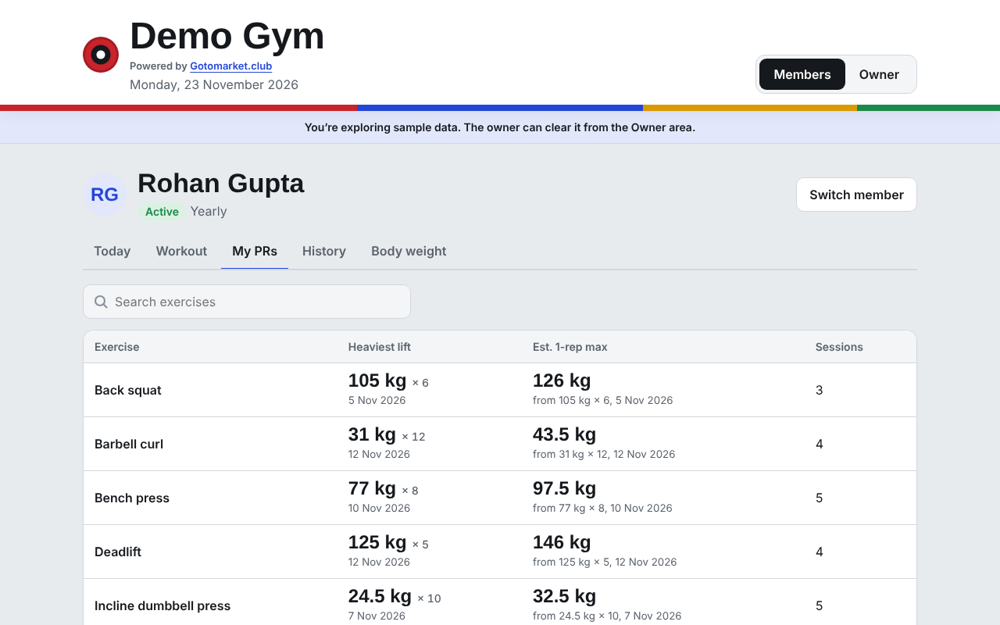

<div align="center">

<picture>
  <source media="(prefers-color-scheme: dark)" srcset="docs/assets/logo-dark.svg">
  
</picture>

### Run your gym. Own your data.

The open-source, self-hosted alternative to paid gym management software.<br>
Attendance, check-in and check-out, memberships, workouts, PRs and WhatsApp reminders, on your own server.

[](LICENSE)
[](https://github.com/namanguptaa/gymverse/actions/workflows/test.yml)
[](https://github.com/namanguptaa/gymverse/pkgs/container/gymverse)
[](https://nodejs.org)
[](package.json)

[Install](#install) · [Features](#features) · [Screenshots](#screenshots) · [Docs](docs/INSTALL.md) · [Contributing](CONTRIBUTING.md)



</div>

## Why GymVerse

Most gym software charges a monthly fee per location and keeps your members' data on someone else's servers. GymVerse is free, runs on a cheap server or a computer at the front desk, and stores everything in a single file you control.

| | GymVerse | Typical paid gym software |
| --- | --- | --- |
| Cost | Free | Monthly subscription |
| Where member data lives | Your own server | The vendor's cloud |
| Works when the internet drops | Yes, changes sync later | Usually not |
| Setup | One command | Account, onboarding, contract |
| Change it to fit your gym | Yes, the code is open | Feature requests only |

## Install

**One command (macOS / Linux)**, using Docker if you have it, otherwise Node.js:

```bash
curl -fsSL https://raw.githubusercontent.com/namanguptaa/gymverse/main/scripts/install.sh | bash
```

**One command (Windows PowerShell)**, needs Docker Desktop:

```powershell
irm https://raw.githubusercontent.com/namanguptaa/gymverse/main/scripts/install.ps1 | iex
```

**Docker, by hand**

```bash
docker run -d --name gymverse -p 3000:3000 -v gymverse-data:/data --restart unless-stopped ghcr.io/namanguptaa/gymverse:latest
```

**Node.js 22.13 or newer**, with no `npm install` needed:

```bash
git clone https://github.com/namanguptaa/gymverse.git && cd gymverse && npm start
```

Open **http://localhost:3000** and create the owner account. Tick **Fill with sample data** to explore a demo gym first, then clear it with one tap when you're ready.

HTTPS, backups, updating and every setting are covered in **[docs/INSTALL.md](docs/INSTALL.md)**.

## Features

| Area | What you get |
| --- | --- |
| **Attendance** | Member self check-in and check-out on a shared tablet, owner marking for any past day, editable times, automatic check-out at closing time or after set hours |
| **Who's inside** | Live list of members in the gym right now, with time inside |
| **Memberships** | Plans with length and price (₹), start and end dates, renewals, fee paid or unpaid |
| **Reminders** | Fee-pending and plan-ending lists with one-tap WhatsApp or SMS messages (editable Hinglish templates) and a log of who was reminded |
| **Workouts** | Routines with sets, reps and target kg, 58 built-in exercises grouped by muscle plus your own, and a set-by-set workout log |
| **Personal records** | Heaviest lift and estimated 1-rep max per exercise, plus a gym-wide PR board |
| **Body weight** | Weight log per member with a chart and change from start |
| **Member profiles** | Calendar of present and absent days, visits with time spent, workouts, PRs and body weight |
| **Reports** | Average workout time, peak hours, 30-day attendance, plans ending soon, unpaid fees |
| **Closed days** | Weekly off days (Sunday by default) and specific closed dates, never counted as absent |
| **Safety** | Owner login, owner PIN for the shared tablet, daily automatic backups, backup download and restore, Excel export |
| **Offline and multi-device** | Changes made offline sync when the connection returns; the tablet and the owner's phone stay in step within seconds |
| **Sample data** | Explore a fully populated demo gym on first run, then clear it in one tap |
| **Design** | Works on phones, tablets and desktops, in light and dark mode, with search on every list |

## Screenshots

| Owner attendance | Member profile |
| --- | --- |
|  |  |
| **Reports and peak hours** | **WhatsApp and SMS reminders** |
|  |  |
| **Workout log** | **Personal records** |
|  |  |

## Architecture

```
  Front-desk tablet        Owner's phone / laptop
         │                          │
         └──────────┬───────────────┘
                    │  HTTPS (via Caddy or Nginx, recommended)
                    ▼
        ┌────────────────────────┐
        │  GymVerse server       │   Node.js built-ins only
        │  server/index.js       │   API + app files
        └───────────┬────────────┘
                    │
        ┌───────────▼────────────┐      ┌──────────────────────┐
        │  data/gymverse.db      │─────▶│  data/backups/       │
        │  SQLite (node:sqlite)  │ daily│  last 30 days        │
        └────────────────────────┘      └──────────────────────┘
```

| Path | Purpose |
| --- | --- |
| `public/` | The browser app: plain HTML, CSS and JavaScript, no build step |
| `server/` | Web server, API, SQLite storage, login, backups, sample data, CLI |
| `scripts/` | One-command installers for macOS, Linux and Windows |
| `test/` | Automated API tests (`npm test`) |
| `docs/` | Install guide, architecture notes, screenshots and logo |

Read [docs/ARCHITECTURE.md](docs/ARCHITECTURE.md) for the data model, sync design, API and security measures.

## Honest status

GymVerse 1.0 covers the daily work of a single small gym: one location, one owner login, members using a shared device. It's used and tested, but it's young. Here's where things stand:

| Works today | Not yet |
| --- | --- |
| Attendance, check-out, plans, fees, reminders, workouts, PRs, reports | Multiple branches in one install |
| Docker and Node.js installs, daily backups, offline sync | Separate logins for trainers or staff |
| WhatsApp and SMS reminders, one tap per member | Fully automatic messages (needs a paid messaging service) |
| English interface with Hinglish reminder templates | Other interface languages |
| | Online payments and invoices |

Want one of these? Open a [feature request](https://github.com/namanguptaa/gymverse/issues/new/choose) or send a pull request.

## Contributing

Bug reports, ideas, translations and pull requests are welcome. Start with [CONTRIBUTING.md](CONTRIBUTING.md) and our [Code of Conduct](CODE_OF_CONDUCT.md). If you use an AI coding tool, point it at [AGENTS.md](AGENTS.md). To report a security problem, see [SECURITY.md](SECURITY.md).

## License

GymVerse is free software under the [GNU Affero General Public License v3.0](LICENSE).

| You can | You must |
| --- | --- |
| Use it for your gym, including commercially | Keep the copyright and license notices |
| Change it to fit your needs | Share your changed source code if you let other people use your changed version over a network |
| Host it for other gyms | Release your changes under the same license |

This summary isn't legal advice; the [LICENSE](LICENSE) file is what counts.

Copyright © 2026 Naman and GymVerse contributors. Powered by [Gotomarket.club](https://gotomarket.club).
